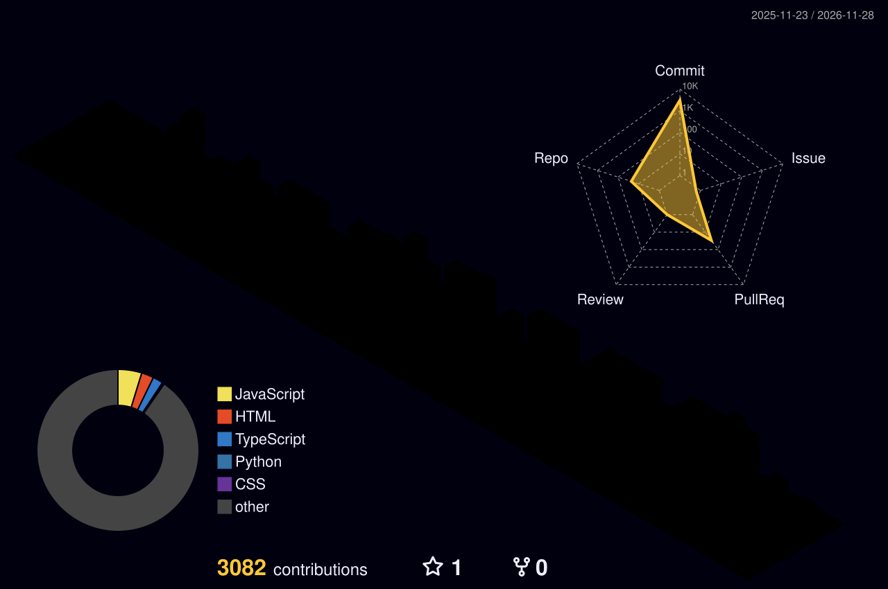

<p align="center">
  
</p>

<p align="center">
  <a href="https://www.linkedin.com/in/mo3d/"></a>
  
  
</p>

<br/>

```ts
// profile.spec.ts — yes, even my README has tests.
describe("Mohammed Al-Salahi", () => {
  it("tests software end-to-end", () => {
    expect(qa.experience).toBe("3 years");
    expect(qa.skills).toContain(["Manual", "API", "Regression", "Bug tracking"]);
  });

  it("builds WordPress sites that just work", () => {
    expect(wordpress.experience).toBe("3 years");
    expect(wordpress.stack).toContain(["Elementor", "WooCommerce", "PHP"]);
  });

  it("writes content that ranks", () => {
    expect(content.experience).toBe("2 years");
    expect(content.focus).toContain(["SEO", "Strategy", "Analytics"]);
  });

  it("is available for your next project", () => {
    expect(contact.linkedin).toBe("linkedin.com/in/mo3d");
  });
});
```

<p align="center">
  
</p>

<h3 align="center">🧰 Toolbox</h3>

<p align="center">
  
</p>

<h3 align="center">🧊 Contributions in 3D</h3>

<p align="center">
  
</p>

<p align="center">
  
</p>

<h3 align="center">🐍 Hunting bugs in my contribution graph</h3>

<p align="center">
  <picture>
    <source media="(prefers-color-scheme: dark)" srcset="https://raw.githubusercontent.com/MO3CODE/mo3code/output/snake-dark.svg" />
    
  </picture>
</p>

<p align="center">
  <b>Need a tester who thinks like a developer — or a developer who tests like a QA?</b><br/>
  <a href="https://www.linkedin.com/in/mo3d/">Let's build something bug-free together →</a>
</p>
